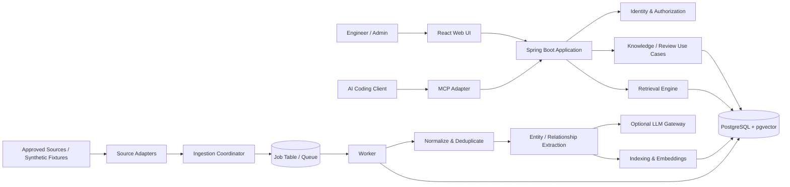

# High-Level Design (HLD)

- Status: Proposed baseline
- Related authority: [PRD](PRD.md), [ADRs](adr/README.md)

## 1. Architectural summary

OneBrain is a modular monolith with asynchronous ingestion and extraction workers. PostgreSQL is the primary system of record for normalized knowledge, entities, relationships, permissions, job state, and audit records. pgvector stores embeddings alongside relational records. The application exposes a human web interface, a REST API, and an MCP server.

The architecture deliberately avoids a separate graph database and microservices in the first release. The product's main risk is retrieval quality and knowledge correctness, not raw throughput. A single relational deployment keeps transactions, authorization, provenance, and lifecycle changes understandable while the product is validated.

## 2. System context

### External actors and systems
- Engineer / contributor / administrator.
- AI coding client using MCP.
- Source systems: initially synthetic fixtures; later read-only GitHub repositories, PRs, and ADR files.
- Optional LLM provider for constrained extraction and optional reranking.
- PostgreSQL with pgvector.

### Trust boundaries
1. Browser or MCP client to API boundary.
2. API to persistence boundary.
3. OneBrain to external source connector boundary.
4. OneBrain to LLM provider boundary.
5. User/agent identity to source authorization mapping boundary.

Every boundary validates inputs and identity. External source content and LLM output are untrusted data.

## 3. Logical components

| Component | Responsibility | Initial deployment |
|---|---|---|
| Web UI | Search, knowledge detail, contribution, admin/review screens | React app |
| API application | Authentication adapter, authorization, use cases, REST contracts | Spring Boot modular monolith |
| MCP adapter | Expose narrow context retrieval tools; delegate to application services | Same deployment/process initially |
| Source adapters | Read/import source data and map upstream identifiers | In-process modules |
| Ingestion coordinator | Idempotency, job lifecycle, retries, scheduling | API + worker process |
| Normalizer | Canonical source envelope, content extraction, fingerprinting | Worker module |
| Knowledge organizer | Entity extraction, entity resolution, relationship proposals | Worker module |
| Indexing | Text indexing and embedding generation/versioning | Worker module |
| Retrieval engine | Hybrid candidate generation, ACL filters, graph expansion, ranking | API module |
| Review and lifecycle | Approval, correction, supersession, archival | API module |
| Persistence | Relational records, vectors, audit, job state | PostgreSQL + pgvector |
| LLM gateway | Provider abstraction, constrained prompts, schema validation | Worker-side adapter |

## 4. Logical architecture diagram

The queue is initially a PostgreSQL-backed job table with worker polling and row locking. A dedicated broker is not justified until measured job volume or operational constraints require one.

## 5. Primary data flows

### 5.1 Publish manually authored knowledge
1. UI sends a validated command to API.
2. API authenticates and authorizes contributor against target scope.
3. Application service writes knowledge item and revision transactionally.
4. Outbox/job record is written in the same transaction.
5. Worker generates normalized search text and embedding, then updates index status.
6. Item becomes searchable only when required indexing state is complete; UI shows processing state meanwhile.

### 5.2 Ingest an external source
1. Admin configures source type, identity, scope mapping, and credentials reference.
2. Adapter reads a source record or fixture.
3. Ingestion coordinator creates/updates a job idempotently using source ID and revision/fingerprint.
4. Worker normalizes the source envelope and stores source snapshot metadata.
5. Deterministic parser extracts obvious metadata; optional LLM proposes structured entities and relationships.
6. Schema validation and policy checks run; proposals retain evidence and review state.
7. Search text and embeddings are generated.
8. Source and derived knowledge are made retrievable subject to mapped permissions.

### 5.3 Retrieve context
1. REST or MCP request enters application boundary with principal and scope.
2. Input is validated and query budget applied.
3. Authorization context is resolved.
4. Lexical and vector candidate searches execute with access predicates.
5. Candidate entities may be expanded through a bounded set of approved edges, with ACL checks at every hop.
6. Ranking applies relevance, evidence, relationship, freshness, and lifecycle features.
7. Results are deduplicated and packed under count/token limits.
8. Response includes safe citations, evidence, freshness, confidence, and explanation metadata.

### 5.4 Correct a relationship
1. User submits feedback or reviewer opens proposal.
2. API checks permission to review the target scope.
3. Review action updates proposal and canonical relationship state transactionally.
4. Audit record is written.
5. Retrieval indexes are refreshed if the change affects searchable state.

## 6. Deployment view

Initial local deployment:
- React static development/build server.
- Spring Boot application.
- Worker process using the same codebase and configuration, separate runtime mode.
- PostgreSQL with pgvector extension.
- Optional LLM API reachable through a configured provider adapter.

Production topology is intentionally unspecified beyond these logical boundaries. Deployment platform, high availability, secrets manager, and SSO are open until target environment and user requirements are known.

## 7. Module boundaries

Use package-by-feature / bounded contexts:
- identity
- authorization
- sources
- ingestion
- knowledge
- ontology
- extraction
- indexing
- retrieval
- review
- audit
- mcp
- api

Modules must depend on application/domain interfaces rather than reaching into another module's persistence implementation. Avoid a generic repository abstraction that hides useful SQL or vector operations.

## 8. Key architectural decisions

- **Modular monolith:** lower operational complexity and easier transaction boundaries.
- **PostgreSQL + pgvector:** relational integrity and vector search in one datastore; typed relationships are relational rows.
- **PostgreSQL job table:** sufficient for initial asynchronous processing and retry semantics.
- **Selective LLM usage:** extraction is a proposal generator, never an authority.
- **MCP as adapter:** MCP exposes application capabilities; it is not the internal data model.
- **REST remains first-class:** web UI and integrations are not coupled to MCP.
- **Source-of-truth separation:** original source systems remain authoritative for upstream documents and code.

## 9. Failure handling

| Failure | Expected behavior |
|---|---|
| Source API unavailable | Mark sync attempt failed/retryable; do not infer deletion |
| Duplicate delivery | Idempotency key prevents duplicate source revision/job effects |
| LLM timeout or malformed output | Retry within bounded policy; preserve source; mark extraction incomplete |
| Embedding provider unavailable | Keep item stored; mark indexing pending; retry asynchronously |
| Worker crash | Lease expires; job can be reclaimed safely |
| Database unavailable | Fail request clearly; no false success response |
| MCP client disconnect | Stop response; do not mutate knowledge |
| ACL mapping missing | Fail closed; source-derived content is not exposed |

## 10. Scaling triggers

Do not split the system preemptively. Revisit architecture only when evidence shows:
- job throughput requires a dedicated broker;
- vector search load requires a separate vector service;
- relationship traversals materially exceed relational query budgets;
- worker CPU/memory isolation is required;
- independent release cadence is needed for a module;
- multiple organizations require stronger isolation than current scope design.

Each trigger requires measurements and an ADR.
